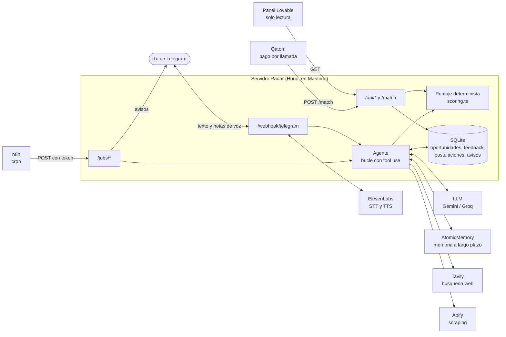
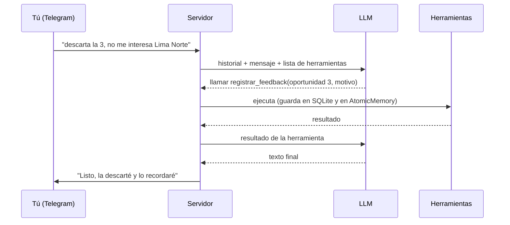
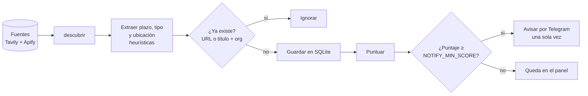

# 📡 Radar

Agente que busca oportunidades para estudiantes (prácticas, becas, hackathones, convocatorias y cursos), las puntúa según tu perfil y tu feedback, y te avisa por Telegram solo las que valen la pena, con plazo y un borrador de postulación. También le puedes escribir o mandarle una nota de voz:

- "¿qué hay para prácticas en banca?"
- "descarta la 3, no me interesa Lima Norte"
- "prepárame el mensaje para postular a la segunda"

**Qué lo hace un agente y no un chatbot:** es proactivo (escanea y avisa solo), usa herramientas (buscar en la web, scrapear portales, consultar su memoria y su base), recuerda tu feedback y lo usa para puntuar mejor, y guarda el estado de cada oportunidad. Nunca envía una postulación: solo prepara borradores.

## Arquitectura

El servidor del agente es el centro. El resto de servicios son brazos que él usa (Tavily, Apify, memoria, voz) o piezas que lo rodean sin tomar decisiones (Telegram transporta, n8n dispara, Maritime aloja).



| Pieza | Rol | Código |
| --- | --- | --- |
| Servidor (Hono + TypeScript) | El cerebro: bucle del agente con *tool use* | `src/` |
| LLM (Gemini o Groq, capa gratuita) | Decide qué herramienta usar y redacta | `src/agent/llm.ts`, `src/agent/providers/` |
| Puntaje determinista | 0–100 con razones, según perfil, feedback y memoria | `src/agent/scoring.ts` |
| SQLite (`node:sqlite`) | Fuentes, oportunidades, postulaciones, feedback | `src/db/` |
| [AtomicMemory](https://github.com/atomicstrata) | Memoria a largo plazo: perfil y lo que descartas | `src/memory/atomicmemory.ts` |
| [Tavily](https://docs.tavily.com) | Búsqueda abierta y enriquecimiento de cada oportunidad | `src/tools/tavily.ts` |
| [Apify](https://docs.apify.com) | Scraping de portales de convocatorias sin API | `src/tools/apify.ts` |
| Telegram (Bot API) | Canal: recibe texto y notas de voz, envía texto y audio | `src/channels/telegram.ts` |
| [ElevenLabs](https://elevenlabs.io/docs) | Voz: transcribe notas de voz y genera audios | `src/voice/elevenlabs.ts` |
| [n8n](https://n8n.io) | Solo dispara los jobs programados | `n8n/` |
| [Maritime](https://maritime.sh) | Hosting del servidor | `deploy/maritime.md` |
| [Lovable](https://lovable.dev) | Panel kanban de solo lectura | `dashboard/PROMPT.md` |
| [Qatom](https://qatom.ai) | Publica `/match` como servicio de pago por llamada | `deploy/qatom.md` |

Cada integración está detrás de una interfaz (`src/interfaces.ts`) con implementación `mock` y `real`, elegida por variable de entorno (`src/deps.ts`). **Sin llaves todo corre en mock**; activas los servicios de uno en uno.

## Cómo funciona

### El bucle del agente (`src/agent/agent.ts`)

El LLM no ejecuta nada: **pide** herramientas y el servidor las ejecuta. Se repite hasta que el LLM responde con texto o se llega a 6 pasos.



Herramientas (`src/agent/tools.ts`):

| Herramienta | Qué hace |
| --- | --- |
| `listar_oportunidades` | Lista y puntúa lo guardado, con filtros por tipo y estado |
| `puntuar_oportunidad` | Calcula el puntaje 0–100 con razones |
| `cambiar_estado` | Mueve una oportunidad: nueva → interesa → postulada → respondida / descartada |
| `registrar_feedback` | Guarda un descarte, un "me interesa" o un comentario general, con su motivo (SQLite y memoria) |
| `redactar_borrador` | Prepara el mensaje de postulación; **nunca lo envía** |
| `buscar_oportunidades` | Busca en la web (Tavily) o recorre las fuentes (Apify) y guarda lo nuevo sin duplicar |
| `enriquecer_oportunidad` | Investiga la organización y los requisitos de una oportunidad (Tavily) |

El historial de cada usuario guarda solo texto (últimos 12 mensajes), y la última lista mostrada, para que "la 3" se entienda.

### Cómo se calcula el puntaje (`src/agent/scoring.ts`)

El número lo calcula código, no el LLM: es testeable, no gasta tokens y `/match` usa la misma función. El LLM solo lo explica con las razones.

Parte de 40 puntos y suma o resta según el perfil (`profile.json`) y lo que el agente ha aprendido de ti:

| Señal | Efecto |
| --- | --- |
| Plazo vencido | 0 y se descarta |
| Es del tipo que buscas (prácticas, becas…) | +20 |
| Coincide con tus intereses (con sinónimos: "IA" ≈ "inteligencia artificial") | +8 por interés, máx. +24 |
| Remoto o en tu ciudad | +8 |
| Presencial en otra ciudad | −15 |
| Se parece a algo que descartaste (feedback o memoria) | −30 |
| Ya descartaste algo de esa organización | −10 |
| Aceptaste antes ese tipo de oportunidad | +5 |

El resultado se limita a 0–100. Por eso, tras reiniciar el servidor con la base vacía, AtomicMemory sigue haciendo bajar una oferta parecida a una que descartaste.

### Descubrimiento y avisos



El mismo `descubrir` lo usan la herramienta del agente, `pnpm escanear` y el job `/jobs/escanear`. Una fuente caída no detiene a las demás.

### Datos (SQLite)

| Tabla | Contenido |
| --- | --- |
| `fuentes` | Portales a scrapear (Apify) y consultas de búsqueda (Tavily), activables |
| `oportunidades` | Cada oportunidad con tipo, plazo, estado, puntaje y razones; la `url` es única |
| `postulaciones` | Borradores de postulación asociados a una oportunidad |
| `feedback` | Qué aceptaste o descartaste y por qué |
| `avisos` | Qué avisos ya se mandaron, para no repetir |

## Estructura

```text
src/
├── index.ts, app.ts       arranque y rutas (Hono)
├── config.ts, deps.ts     lectura del .env y elección mock/real de cada integración
├── interfaces.ts, types.ts contratos de las integraciones y tipos del dominio
├── agent/                 bucle, prompt, herramientas, puntaje, descubrimiento, proveedores de LLM
├── db/                    esquema, consultas y datos de prueba
├── channels/              telegram.ts (real) y mock.ts
├── voice/, memory/, tools/  ElevenLabs, AtomicMemory, Tavily y Apify
├── mensajeria.ts          une canal, voz y agente (permisos, duplicados, notas de voz)
├── jobs.ts                lógica de los avisos programados
└── match.ts               entrada del servicio /match
tests/                     Vitest, todo con mocks y sin red
n8n/  deploy/  dashboard/  workflows, guías de despliegue y prompt del panel
```

## Arrancar (sin llaves)

Requiere Node 22.13+ y pnpm.

```bash
pnpm install
cp .env.example .env
pnpm seed        # 15 oportunidades ficticias en data/radar.db
pnpm dev         # http://localhost:3000
pnpm test        # Vitest
```

```bash
curl -X POST localhost:3000/ask -H "content-type: application/json" -d '{"text":"que hay para practicas?"}'
curl -X POST localhost:3000/ask -H "content-type: application/json" -d '{"text":"descarta la 3, no me interesa Lima Norte"}'
curl -X POST localhost:3000/ask -H "content-type: application/json" -d '{"text":"preparame el mensaje para postular a la primera"}'
```

En Windows las tildes en `-d` pueden llegar mal: usa `--data-binary @pregunta.json`.

Edita `profile.json` con tu perfil: el puntaje y el prompt lo usan.

## Activar servicios reales

Todo tiene capa gratuita sin tarjeta. En `.env`:

| Servicio | Variables | Notas |
| --- | --- | --- |
| LLM | `LLM_PROVIDER=gemini` + `GEMINI_API_KEY` ([AI Studio](https://aistudio.google.com/apikey)) o `LLM_PROVIDER=groq` + `GROQ_API_KEY` ([Groq](https://console.groq.com/keys)) | `LLM_MODEL` opcional |
| Memoria | `MEMORY_MODE=real`, `ATOMICMEMORY_URL`, `ATOMICMEMORY_API_KEY` | Cloud, o local con `docker compose up -d` (necesita `GROQ_API_KEY`; embeddings locales) |
| Tavily | `TAVILY_MODE=real`, `TAVILY_API_KEY` | 1,000 créditos/mes gratis; cada búsqueda cuesta 1 |
| Apify | `APIFY_MODE=real`, `APIFY_TOKEN` | La primera vez hay que aprobar los permisos del actor `apify/cheerio-scraper` (el error trae el enlace) |
| Voz | `VOICE_MODE=real`, `ELEVENLABS_API_KEY`, `ELEVENLABS_VOICE_ID` | El plan Free no permite voces de la biblioteca por API: usa una predeterminada |

### Descubrimiento

```bash
pnpm fuentes                       # lista las fuentes; `pnpm fuentes desactivar 3` / `activar 3`
pnpm escanear                      # recorre las fuentes activas (Tavily + Apify) y guarda lo nuevo
pnpm escanear "becas cloud Perú"   # búsqueda puntual en Tavily
```

Por chat: *"busca prácticas de telecomunicaciones en Lima"*, *"escanea las fuentes"*, *"investiga la 2"*. Todo se deduplica por URL y por título + organización.

### Telegram

1. En Telegram habla con [@BotFather](https://t.me/BotFather), `/newbot`, guarda el token.
2. Necesitas una URL pública: en local un túnel (`cloudflared tunnel --url http://localhost:3000`), en producción la de Maritime.
3. `.env`:

```env
CHANNEL=telegram
TELEGRAM_BOT_TOKEN=…            # el de BotFather
TELEGRAM_WEBHOOK_SECRET=…       # inventa uno: letras, números, _ o - (openssl rand -hex 24)
PUBLIC_URL=https://TU-URL
ALLOWED_SENDERS=                # vacío al principio
```

4. `pnpm dev` registra solo el webhook. Escríbele "hola" al bot: te responde con **tu ID**. Ponlo en `ALLOWED_SENDERS` y reinicia. Solo ese ID puede usar el agente (el bot es público y cada pregunta gasta cuota).

Un bot de Telegram solo tiene **un** webhook: si dos servidores arrancan con el mismo token se pisan. Para desarrollar en local con el servidor desplegado, crea un segundo bot.

### Voz

Nota de voz → texto (`scribe_v2`) → agente → (con `REPLY_AS_VOICE=true`) audio de respuesta (`eleven_multilingual_v2`). Si la voz falla, siempre llega la respuesta por texto. Para ahorrar créditos, lo que se pronuncia se acorta a ~900 caracteres sin enlaces ni emojis.

## Avisos automáticos (n8n)

El agente avisa **solo** lo que vale la pena (puntaje ≥ `NOTIFY_MIN_SCORE`, 70 por defecto) y nunca repite un aviso. n8n solo dispara; la lógica está en `src/jobs.ts`.

| Job | Qué hace | Cron (Lima) |
| --- | --- | --- |
| `POST /jobs/escanear` | Recorre las fuentes activas y avisa las nuevas que superan el umbral | `0 8 * * *` |
| `POST /jobs/recordar-plazos` | Avisa lo que te interesa (o puntúa alto) y cierra en ≤ 3 días | `0 9 * * *` |
| `POST /jobs/resumen-semanal` | Resumen de las mejores y cuántas cierran en 7 días (también en audio con `REPLY_AS_VOICE`) | `0 19 * * 0` |

Cada job exige `JOBS_TOKEN` en `Authorization: Bearer …` o en `X-Radar-Token`. Para usarlos, importa `n8n/*.json` en n8n, cambia `https://TU-URL-PUBLICA` por la URL de tu servidor y `CAMBIA_ESTE_TOKEN` por tu `JOBS_TOKEN`, y **publica** cada workflow.

## Despliegue

`Dockerfile` listo (Node 24, SQLite en `/data`). Guía en [deploy/maritime.md](deploy/maritime.md). En producción (`NODE_ENV=production`) `/ask`, `/chat` y `/api/*` exigen `API_TOKEN`, porque la URL pública no tiene login.

Probar la imagen en local: `docker build -t radar . && docker run --rm -p 3000:3000 -e API_TOKEN=x radar` y `curl localhost:3000/health`.

## Panel y servicio `/match`

- **Panel (Lovable):** prompt listo en [dashboard/PROMPT.md](dashboard/PROMPT.md). Usa `PANEL_TOKEN` (solo lee `/api/*`) en la URL, `?token=…`.
- **Qatom:** [deploy/qatom.md](deploy/qatom.md) explica cómo publicar `/match` (puntaje 0–100 por llamada). Con `MATCH_TOKEN` el endpoint responde 404 sin el token.

## Rutas

| Ruta | Qué hace |
| --- | --- |
| `GET /health` | Qué integraciones están en mock y cuáles en real |
| `POST /ask` `{ text, usuario? }` | Conversa con el agente |
| `POST /chat` `{ message, source? }` | Contrato de Maritime para contenedores propios → `{ response }` |
| `POST /match` (o `GET`) | Puntaje 0–100 y razones. Forma anidada `{ oportunidad, perfil? }` o plana (`titulo`, `tipo`, `intereses`…) |
| `GET /api/oportunidades?estado=&tipo=` | Lista para el panel |
| `GET /api/postulaciones`, `GET /api/estadisticas` | Datos para el panel |
| `POST /jobs/{escanear,recordar-plazos,resumen-semanal}` | Disparadores de n8n |
| `POST /webhook/telegram` | Mensajes de Telegram (secreto `X-Telegram-Bot-Api-Secret-Token`); contesta 200 al instante y responde en segundo plano |

## Tokens

| Variable | Protege |
| --- | --- |
| `API_TOKEN` | `/ask`, `/chat` y todo `/api/*` |
| `PANEL_TOKEN` | Solo lectura de `/api/*` (va en el navegador del panel) |
| `JOBS_TOKEN` | `/jobs/*` |
| `MATCH_TOKEN` | `/match` |

Los tokens se aceptan como `Authorization: Bearer …` o `X-Radar-Token: …` (la URL pública de Maritime no reenvía `Authorization`).

## Limitaciones conocidas

- Tavily trae sobre todo portales agregadores y la mayoría de resultados salen **sin plazo**: no se inventa la fecha.
- Los portales de Apify se leen con un `pageFunction` genérico; uno con mucho JavaScript necesitaría otro actor (p. ej. Playwright).
- Las herramientas del agente no tienen efectos externos (solo borradores y datos internos). Si se agrega una acción con efecto, debe pedir confirmación explícita.
